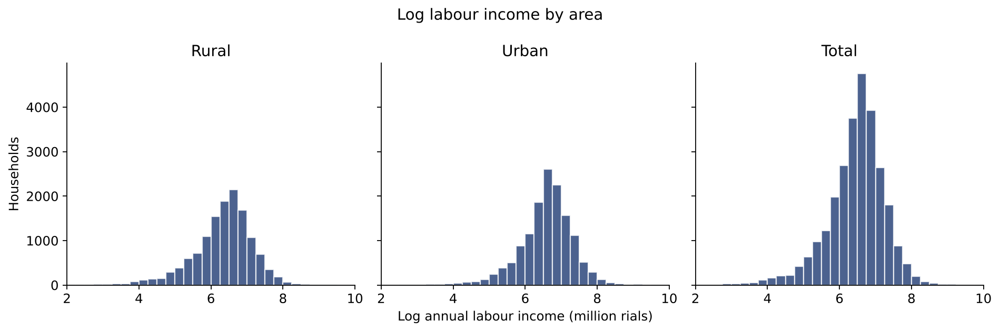

# Household Expenditure and Income Survey 1401

How much of an increase in labour income goes into education spending, and does this differ between urban and rural households? Data: the 1401 (2022-23) Iranian Household Expenditure and Income Survey.

## Data

Raw tables in `data/raw`, rural (`R`) and urban (`U`) versions of each:

| Table | Content |
|---|---|
| `R1401P1.dta`, `U1401P1.dta` | Household members |
| `R1401P3S13.dta`, `U1401P3S13.dta` | Annual expenditure items |
| `R1401P4S01.dta`, `U1401P4S01.dta` | Income from wage jobs |
| `R1401P4S02.dta`, `U1401P4S02.dta` | Income from self-employment |

`code/01_build_household.do` appends the rural and urban tables and builds one row per household (`data/heis1401_household.dta`). `code/02_regressions.do` produces the comparison, the histogram and the regression table.

## Specification

$$
\text{edu}_i = \beta_0 + \beta_1\,\text{income}_i + \beta_2\,\text{urban}_i + \beta_3\,(\text{income}_i \times \text{urban}_i) + \beta_4\,\text{agehead}_i + \gamma_{p(i)} + \varepsilon_i
$$

- **Unit and sample:** households with at least one wage or self-employment income record; 27,552 households (13,507 rural, 14,045 urban).
- **Outcome:** annual education spending, the sum of all items in COICOP division 10 in the annual expenditure table, in million rials. Households with no education items are set to zero (58% of the sample).
- **Income:** annual net income from all wage jobs and self-employment of household members, in million rials.
- **Urban:** first digit of the household address code is 1. **Province:** digits 2-3 of the address code.
- **Columns:** (1) income only; (2) adds the urban dummy; (3) adds the income × urban interaction; (4) adds the age of the household head; (5) same as (4) with robust standard errors; (6) adds province fixed effects.
- **Standard errors:** conventional OLS in columns (1)-(4), heteroskedasticity-robust (HC1) in (5)-(6). Survey weights are not used.

## Results

Mean education spending is 3.8 million rials in rural households and 10.0 million in urban households; mean labour income is 756 and 940 million rials.

Dependent variable: annual education spending (million rials)

| | (1) | (2) | (3) | (4) | (5) | (6) |
|---|---:|---:|---:|---:|---:|---:|
| Labour income | 0.0058*** | 0.0055*** | 0.0022*** | 0.0022*** | 0.0022*** | 0.0017*** |
| | (0.0002) | (0.0002) | (0.0003) | (0.0003) | (0.0005) | (0.0004) |
| Urban | | 5.232*** | 0.757 | 0.657 | 0.657 | 0.288 |
| | | (0.383) | (0.529) | (0.530) | (1.655) | (1.596) |
| Income × Urban | | | 0.0054*** | 0.0054*** | 0.0054*** | 0.0055*** |
| | | | (0.0004) | (0.0004) | (0.0020) | (0.0019) |
| Age of head | | | | -0.044*** | -0.044*** | -0.052*** |
| | | | | (0.015) | (0.009) | (0.010) |
| Constant | 2.060*** | -0.347 | 2.121*** | 4.300*** | 4.300*** | 4.348*** |
| | (0.265) | (0.317) | (0.375) | (0.832) | (0.586) | (0.841) |
| Province FE | | | | | | Yes |
| Robust SE | | | | | Yes | Yes |
| Observations | 27,552 | 27,552 | 27,552 | 27,552 | 27,552 | 27,552 |
| R² | 0.025 | 0.032 | 0.037 | 0.037 | 0.037 | 0.045 |

\* p<0.10, \*\* p<0.05, \*\*\* p<0.01

An extra million rials of labour income goes with about 2,200 rials more education spending in rural households and about 7,600 rials in urban households (column 4). Once the interaction is included, the urban dummy itself is small and not significant, so the urban-rural gap in spending comes mostly through income. The R² stays below 5%: income explains little of the variation in education spending. These are associations, not causal effects; household size, number of school-age children and parental education are left out.
