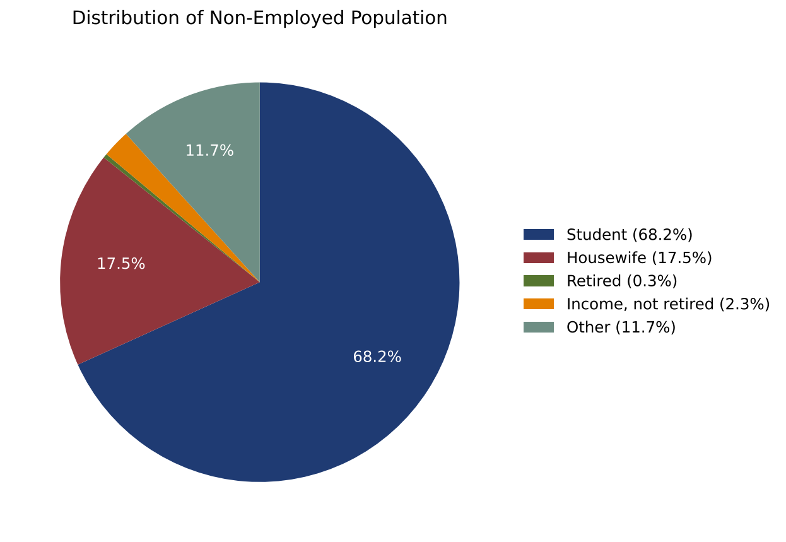
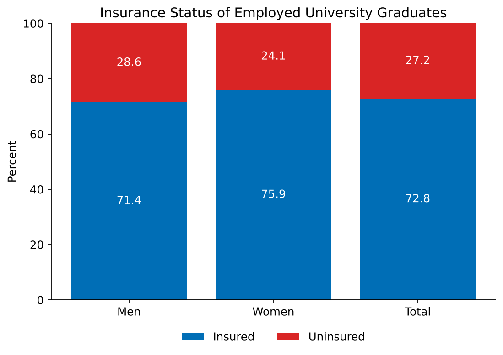

# Labour Force Survey 1402

Descriptive analysis of the 1402 (2023-24) Iranian Labour Force Survey.

**Data:** `data/LFS1402.dta`, the individual-level file (656,578 records). All figures are unweighted sample counts and means.

**Code**

| File | Question |
|---|---|
| `code/01_gender_ratio.do` | Gender ratio of university graduates (bachelor, master, doctorate) in urban and rural areas |
| `code/02_age_by_status.do` | Activity status of the non-employed and the mean age of each group |
| `code/03_insurance.do` | Insurance coverage of employed university graduates by gender |
| `code/04_experience.do` | Years in the current job and total work experience by sector (ISIC) and gender |

Main variables: area from the 5th digit of `pkey`, gender `F2_D04`, age `F2_D07`, education `F2_D17`, insurance `F3_D13`, sector `F3_D10` (two-digit ISIC: agriculture 01-03, industry 05-43, services 45-99), tenure `F3_D14SAL`, experience `F3_D15SAL`, activity status `F3_D36`.

## Results

**University graduates by area and gender**

| Area | Men | Women | Men (%) | Women (%) |
|---|---:|---:|---:|---:|
| Urban | 32,803 | 30,996 | 51.4 | 48.6 |
| Rural | 6,762 | 5,812 | 53.8 | 46.2 |

**Non-employed population by activity status**

| Status | N | Share (%) | Mean age |
|---|---:|---:|---:|
| Student | 4,911 | 68.2 | 26.7 |
| Housewife | 1,260 | 17.5 | 33.3 |
| Retired | 24 | 0.3 | 51.4 |
| Income, not retired | 162 | 2.3 | 31.7 |
| Other | 841 | 11.7 | 28.4 |

**Insurance coverage of employed university graduates**

The insurance question is asked only of people in work, so the sample is employed graduates who answered it.

| Group | N | Insured (%) | Uninsured (%) |
|---|---:|---:|---:|
| Men | 25,766 | 71.4 | 28.6 |
| Women | 11,081 | 75.9 | 24.1 |
| Total | 36,847 | 72.8 | 27.2 |

**Mean years in current job and total experience**

| Sector | Group | Current job | Total experience |
|---|---|---:|---:|
| Agriculture | Men | 19.58 | 27.11 |
| | Women | 17.59 | 20.83 |
| | Total | 19.24 | 26.05 |
| Industry | Men | 11.15 | 18.37 |
| | Women | 9.22 | 11.34 |
| | Total | 10.90 | 17.45 |
| Services | Men | 10.30 | 18.77 |
| | Women | 8.14 | 9.74 |
| | Total | 9.89 | 17.04 |
